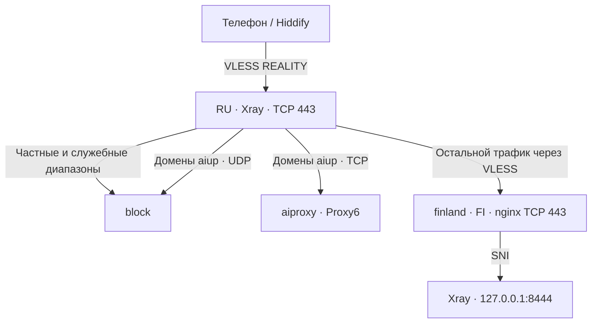

# Каскад Россия-Финляндия

Памятка для Комбайна. Схема и результаты проверок от 25.11.2026.

## Как идёт трафик



Профиль Hiddify смотрит на вход RU. Каскад с RU подключается к внешнему TCP 443 на FI. Nginx передаёт соединение на локальный Xray по SNI. Правила Xray проверяются по порядку. Выход `finland` добавляется последним, после `block` и aiproxy. Список доменов берёт модуль aiup.

## Что проверили

- С RU открылся TCP 443 на FI. Рабочий конфиг с finland прошёл xray run -test, после перезапуска kombain-xray был active.

- YouTube Shorts воспроизводились на телефоне по мобильной сети. Журнал RU показал [vless -> finland] для запросов YouTube.

- В RU остались правила aiup и выход aiproxy. Отдельной проверки запросов к нейросетям через Proxy6 в этом сеансе не зафиксировано.

- Хук в vless.sh установили, bash -n прошёл. Последний aiup sync сообщил, что список доменов остался прежним, и пропустил пересборку. Проверка с реальным вызовом vls_write_conf ещё нужна.

Финляндию выбрали после теста RU → Fornex 22.11.2026. В парном захвате TCP-рукопожатие прошло. ClientHello вышел с RU и отсутствовал в захвате на Fornex. Причину потери по этим данным определить нельзя.

## Как восстановить схему

На FI подготовь отдельного VLESS-клиента для каскада. Из его профиля нужны внешний адрес, порт, UUID, SNI, публичный ключ REALITY и short ID. Для этой установки SNI — `www.yahoo.com`, fingerprint — `firefox`, flow — xtls-rprx-vision. Параметры входа RU остаются в профиле телефона.

На RU проверь TCP 443 до FI командой nc -zv -w 3 <FI_HOST> 443. Сохрани резервные копии рабочего `/opt/kombain/vless/config.json` и `/opt/kombain/src/modules/vless.sh.` Проверь, что `aiup` включён и текущая сборка вызывает aup_apply.

Сохрани на RU отдельный outbound в `/opt/kombain/vless/cascade-upstream.json` с владельцем root и правами 0600. Подставь параметры клиента FI. В образце адрес, UUID, ключ и short ID служат заглушками.

```json
{
  "tag": "finland",
  "protocol": "vless",
  "settings": {
    "vnext": [
      {
        "address": "203.0.113.10",
        "port": 443,
        "users": [
          {
            "id": "00000000-0000-0000-0000-000000000000",
            "encryption": "none",
            "flow": "xtls-rprx-vision"
          }
        ]
      }
    ]
  },
  "streamSettings": {
    "network": "tcp",
    "security": "reality",
    "realitySettings": {
      "serverName": "www.yahoo.com",
      "fingerprint": "firefox",
      "publicKey": "<FI_REALITY_PUBLIC_KEY>",
      "shortId": "<FI_SHORT_ID>"
    }
  }
}
```

В `vls_write_conf` добавь блок сразу после `aup_apply` и перед проверкой "$VLS_BIN" run -test. Блок обрабатывает `config.new.json`, сохраняет порядок существующих правил и дописывает последний маршрут finland. При ошибке сборки рабочий `config.json` остаётся на месте.

```bash
  if [ -e "$VLS_DIR/cascade-upstream.json" ]; then
    if ! jq -e --slurpfile cascade "$VLS_DIR/cascade-upstream.json" '
      if ($cascade | length) != 1 or $cascade[0].tag != "finland"
         or $cascade[0].protocol != "vless" then
        error("expected one VLESS outbound tagged finland")
      else
        .outbounds |= (map(select(.tag != "finland")) + [$cascade[0]])
        | .routing.rules |= (map(select(.outboundTag != "finland")) + [
            {type: "field", port: "0-65535", outboundTag: "finland"}
          ])
      end
    ' "$VLS_DIR/config.new.json" > "$VLS_DIR/config.new.json.c"; then
      rm -f "${VLS_DIR:?}/config.new.json" "${VLS_DIR:?}/config.new.json.c"
      return 1
    fi
    mv -f "$VLS_DIR/config.new.json.c" "$VLS_DIR/config.new.json" || return 1
  fi
```

Запусти `bash -n` `/opt/kombain/src/modules/vless.sh.` Затем пересобери конфиг штатным действием Комбайна. На сборке с CLI можно добавить временного клиента с новым именем через `kombain cli vless add-client cascade-check`, проверить маршруты и удалить его через kombain cli vless rm-client cascade-check.

## Проверка после пересборки

```bash
systemctl is-active kombain-xray
jq '{
  outbounds: [.outbounds[].tag],
  rules: [.routing.rules[] | {
    outboundTag, network, port,
    private_ranges: has("ip"),
    domain_rule: has("domain")
  }]
}' /opt/kombain/vless/config.json
journalctl -u kombain-xray --since "5 minutes ago" --no-pager
```

Ждём `active`, выходы `aiproxy` и `finland` и последнее правило с finland. С профилем RU открой YouTube и сервис из списка aiup. В журнале RU проверь отдельно `[vless -> finland]` и [vless -> `aiproxy`]. Для фиксации пересборки сравни время изменения `config.json` до и после. Сообщение «Список доменов прокси не менялся» само по себе пересборку не подтверждает.

## Откат и обновление

Для планового отключения переименуй `cascade-upstream.json`, добавив .off, и запусти реальную пересборку. Проверь, что `aiproxy` остался, `finland` исчез, а служба активна. В этой схеме остальной трафик после отката выйдет через `direct` на RU.

При неудачном запуске восстанови сохранённый рабочий `config.json` и проверь его через `/usr/local/lib/kombain/xray` run -test -config `/opt/kombain/vless/config.json` перед перезапуском. Если причина в локальной правке, восстанови также резервную копию vless.sh.

После обновления Комбайна проверь наличие хука в `vls_write_conf` и повтори проверку пересборки. Локальная правка `vless.sh` может быть заменена версией из Git.

## Материалы

- [Генератор VLESS в ветке aiup](https://github.com/ln71v/kombain/blob/aiup/modules/vless.sh#L111-L155)

- [Правила прокси для нейросетей](https://github.com/ln71v/kombain/blob/aiup/modules/aiup.sh#L118-L150)

- [Порты Комбайна](https://github.com/ln71v/kombain/blob/main/docs/DEV-PORTS.md)
